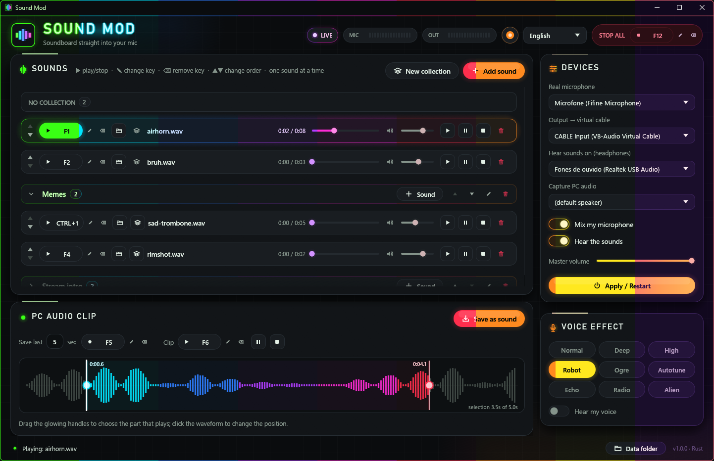

# Sound Mod · Rust Neon Edition

**English** | [Português](README.pt-BR.md)



**A Windows soundboard that plays sounds straight into your microphone**, rebuilt in Rust with a dark-graphite and fluorescent-green neon interface. Press a key (or click a button) and the sound goes out on your mic channel for Discord, games, calls and streams, while you keep talking normally.

It can also record the **last few seconds of your PC audio** (5 s by default) so you can trim it and play it back on your mic.

## Features

- **Global hotkeys**: F1, F2, F3... play different sounds even with the app in the background **or minimized**. Press once to play, press again to stop. Keys can be changed (Esc cancels) or removed, and combos like `Ctrl+1` work. The hook only observes, so the key still reaches your game.
- **Mic + sounds together**: mixes your real microphone with the sounds, with no device switching.
- **Many formats, nothing to install**: mp3, wav, ogg, flac, m4a/aac, opus, aiff... decoded natively. For anything else (e.g. wma), drop an `ffmpeg.exe` next to the program.
- **Per-sound controls**: ▶ play, ⏸ pause/resume, ■ stop, draggable progress bar (seek) and individual live volume.
- **One sound at a time**: playing a sound interrupts the current one.
- **Add many files at once**: **Add sound** accepts several files; they fill the empty slots first.
- **Voice effects**: Deep, High, Robot, Ogre, Autotune, Echo, Radio and Alien, applied live to your mic. Turn on **Hear my voice** to monitor yourself.
- **PC audio clip**: one key saves the last N seconds to `clips/last_clip.wav`, another plays it. Drag the neon handles on the waveform to **choose the part** that plays, and **Save as sound** keeps that part as a new sound (stored in `sounds/`).
- **Headphone monitor**: you hear the sounds while they go out on your mic.
- **Live level meters** for the mic and the output, and a pulsing **Live** indicator.
- **English and Portuguese**: follows your Windows language, switchable at any time.
- **Single `.exe`**, no runtime, no Python, starts instantly.

## How it works

Windows doesn't allow injecting audio into a physical microphone, so the app uses a **virtual audio cable** (VB-CABLE):

```
Real microphone ──┐
                  ├─► Sound Mod ─► CABLE Input ═► CABLE Output ─► Discord/game (as microphone)
Sounds (F1, F2...)┘      └─► your headphones (monitor)
```

## Installation

> **No release yet.** The project is still being polished before v1.0; for now, build it from source as described below.

1. Install [VB-CABLE](https://vb-audio.com/Cable/) (free) and restart your PC.
2. Build the program (below) and open `dist\SoundMod\SoundMod.exe`. Keep it in its own folder: settings, clips and saved sounds live next to it.

### Building

Requires Windows 10/11 and [rustup](https://rustup.rs). **Visual Studio is not needed.**

```powershell
powershell -ExecutionPolicy Bypass -File build.ps1
```

This creates `dist\SoundMod\SoundMod.exe`. Rebuilding only replaces the `.exe`, so your `config.json`, `clips\` and `sounds\` are kept. Other modes: `build.ps1 -Run` (debug build and open), `build.ps1 -Test` (unit tests), `build.ps1 -Test -Hardware` (also plays a short quiet tone into VB-CABLE and records it back to check the whole audio path; nothing comes out of your speakers).

The project uses the GNU Rust toolchain (pinned in `rust-toolchain.toml`) linked with LLVM's `rust-lld`, both installed by rustup. `build.ps1` also prepares the `dlltool` the Windows crates need (it is LLVM's `llvm-ar` from the `llvm-tools` component).

## How to use

1. **Real microphone**: your physical mic. **Output → virtual cable**: `CABLE Input`. **Hear sounds on**: your headphones (don't choose the cable here). The app picks these automatically the first time.
2. In Discord or your game, choose **CABLE Output** as the microphone. In Discord, turn off Noise Suppression, Echo Cancellation and Automatic Gain Control, which tend to cut sound effects.
3. Assign files to the slots. Each key button is split: **▶ F1** plays and, pressed again, stops; **✎** changes the key; **⌫** removes the key. Only one sound plays at a time.
4. **F5** saves the last N seconds of PC audio and shows the waveform; drag the green handles to choose the part. **F6** plays that part. **F12** stops everything. **Save as sound** asks for a name and adds the selected part to your sounds.
5. **Voice effect**: pick an effect in the side panel. It changes your mic live; **Normal** turns it off. Check **Hear my voice** to monitor yourself.

Device changes take effect when you click **Apply / Restart**; switches and volumes apply immediately.

## Coming from the Python version

This is a Rust rewrite of [Sound Mod (Python)](https://github.com/renanzm/sound-mod). `config.json` uses the same format, so you can copy your `config.json` and `sounds\` folder next to the new `.exe` and keep your slots, keys and devices. Differences: clips and saved sounds are stored as WAV (lossless, no encoder needed) instead of MP3, and the existing `last_clip.mp3` is not used.

## Documentation

Architecture and development guide (in Portuguese): [docs/ARQUITETURA.md](docs/ARQUITETURA.md).

## Known limitations

- Windows only (WASAPI, low-level keyboard hook, DWM window styling).
- Requires VB-CABLE (or another virtual cable).
- To catch keys while a game running as administrator is focused, run Sound Mod as administrator.
- WASAPI loopback delivers nothing while the PC is silent, so the clip can be empty ("Nothing recorded yet").

## License

[MIT](LICENSE)
