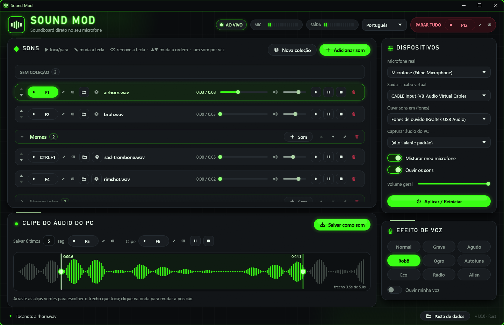

# Sound Mod

[English](README.md) | **Português**



**Soundboard para Windows que toca sons direto no seu microfone**, refeito em Rust com uma interface neon escura em 8 cores e um tema Vice City. Aperte uma tecla (ou clique num botão) e o som sai no canal do microfone, para Discord, jogos, chamadas e streams, enquanto você continua falando normalmente.

Também grava os **últimos segundos do áudio do PC** (padrão 5 s) para você cortar e reproduzir no microfone.

## Recursos

- **Hotkeys globais**: F1, F2, F3... tocam sons diferentes mesmo com o app em segundo plano **ou minimizado**. Aperte uma vez para tocar e de novo para parar. As teclas podem ser trocadas (Esc cancela) ou removidas, e combinações como `Ctrl+1` funcionam. O gancho só observa: a tecla continua chegando ao jogo.
- **Mic + sons juntos**: mistura seu microfone real com os sons, sem trocar de dispositivo.
- **Vários formatos, nada para instalar**: mp3, wav, ogg (Vorbis), flac, m4a/aac, aiff... decodificados nativamente. Para o resto (ex.: wma, opus), coloque um `ffmpeg.exe` ao lado do programa.
- **Controle por som**: ▶ tocar, ⏸ pausar/continuar, ■ parar, barra de progresso arrastável e volume individual ao vivo.
- **Um som por vez**: tocar um som interrompe o atual.
- **Vários arquivos de uma vez**: o **Adicionar som** aceita vários arquivos; eles ocupam primeiro os slots vazios.
- **Todos os sons numa pasta só**: os arquivos adicionados são copiados para a pasta `sounds` do app (os originais ficam onde estavam), junto com os sons criados pelo **Salvar como som**. Um arquivo idêntico que já esteja lá é reaproveitado em vez de duplicado. O botão **Abrir pasta** abre essa pasta. Sons de configurações antigas que estão em outros lugares são copiados uma vez.
- **Lista compacta**: o interruptor **Lista compacta** no cartão de sons deixa cada linha mais fina (botões menores, espaçamento menor), cabendo cerca de 50% mais sons na janela. A escolha fica salva.
- **Ordem e coleções**: as setas ▲▼ mudam a ordem de cada som (dentro do grupo) e a ordem fica salva. Agrupe os sons em **coleções** que você cria, renomeia, reordena, recolhe e apaga (apagar uma coleção não apaga os sons: eles vão para *Sem coleção*). Cada som tem um menu para trocar de coleção, e o **+ Som** de uma coleção adiciona arquivos direto nela. As teclas continuam funcionando para os sons de coleções recolhidas.
- **Efeitos de voz**: Grave, Agudo, Robô, Ogro, Autotune, Eco, Rádio e Alien, aplicados ao vivo no microfone. Ligue **Ouvir minha voz** para se escutar.
- **Clipe do áudio do PC**: uma tecla salva os últimos N segundos em `clips/last_clip.wav`; outra toca. Arraste as alças neon na forma de onda para **escolher o trecho**, e **Salvar como som** guarda esse trecho como um som novo (na pasta `sounds/`).
- **Monitor nos fones**: você ouve os sons enquanto eles saem no microfone.
- **Medidores de nível** do microfone e da saída, e indicador **Ao vivo** pulsando.
- **8 cores de neon e um tema**: verde, ciano, azul, roxo, rosa, vermelho, laranja ou amarelo, ou o tema **Vice City** (fundos em violeta da noite e degrade magenta → coral → laranja → amarelo quente no título, botões, sliders, medidores e forma de onda), escolhidos na bolinha acesa do cabeçalho. A interface inteira, a borda da janela e o ícone da janela mudam na hora, e a escolha fica salva. O print acima mostra as nove opções, uma fatia de cada.
- **Ícone colorido**: as cinco barrinhas de som do logo brilham cada uma numa cor (nas cores do Vice City quando o tema está ligado); a moldura segue a cor escolhida.
- **Português e inglês**: segue o idioma do Windows e pode ser trocado a qualquer momento.
- **Seus dados sobrevivem às atualizações**: configuração, sons salvos e clipe ficam em `%APPDATA%\SoundMod`, fora da pasta do programa, então substituir o programa não apaga nada. O botão **Pasta de dados** (canto inferior direito) abre essa pasta.
- **Um único `.exe`**, sem runtime nem Python, abre na hora.

## Como funciona

O Windows não permite injetar áudio num microfone físico, então o app usa um **cabo de áudio virtual** (VB-CABLE):

```
Microfone real ──┐
                 ├─► Sound Mod ─► CABLE Input ═► CABLE Output ─► Discord/jogo (como microfone)
Sons (F1, F2...) ┘      └─► seus fones (monitor)
```

## Instalação

1. Instale o cabo virtual [VB-CABLE](https://vb-audio.com/Cable/) (gratuito) e **reinicie o PC**. O manual explica [o que ele é e como instalar](docs/MANUAL.pt-BR.md#2-o-cabo-virtual-vb-cable).
2. Baixe o **`SoundMod-v1.0.0-windows-x64.zip`** (programa + manual offline) ou só o **`SoundMod.exe`** na **[última release](https://github.com/renanzm/sound-mod-rs/releases/latest)**.
3. Extraia numa pasta sua e abra o `SoundMod.exe`. Não precisa instalar mais nada. Configurações, clipes e sons ficam em `%APPDATA%\SoundMod`.

> [!NOTE]
> O programa ainda não é assinado digitalmente, então o SmartScreen do Windows pode dizer "O Windows protegeu o computador" na primeira vez: clique em **Mais informações → Executar assim mesmo**.

**Guia completo:** o **[manual de uso](docs/MANUAL.pt-BR.md)** explica o cabo virtual, a primeira configuração, Discord e jogos, todas as funções e a solução de problemas.

### Compilar a partir do código

Requer Windows 10/11 e o [rustup](https://rustup.rs). **Não precisa do Visual Studio.**

```powershell
powershell -ExecutionPolicy Bypass -File build.ps1
```

Gera `dist\SoundMod\SoundMod.exe` (seus dados ficam em `%APPDATA%\SoundMod`, então recompilar nunca mexe neles). Outros modos: `build.ps1 -Run` (compila em debug e abre), `build.ps1 -Test` (testes), `build.ps1 -Package` (`.zip` da release com o exe e os manuais em HTML), `build.ps1 -Test -Hardware` (também toca um tom curto e baixo no VB-CABLE e grava de volta para conferir todo o caminho do áudio; nada sai nos seus alto-falantes).

O projeto usa o toolchain GNU do Rust (fixado no `rust-toolchain.toml`) com o linker `rust-lld` do LLVM, ambos instalados pelo rustup. O `build.ps1` também prepara o `dlltool` que as crates do Windows exigem (é o `llvm-ar` do componente `llvm-tools`).

## Como usar

1. **Microfone real**: seu microfone físico. **Saída → cabo virtual**: `CABLE Input`. **Ouvir sons em**: seus fones (não escolha o cabo aqui). O app escolhe isso sozinho na primeira vez.
2. No Discord ou no jogo, escolha **CABLE Output** como microfone. No Discord, desligue Supressão de ruído, Cancelamento de eco e Controle automático de ganho, que costumam cortar os efeitos sonoros.
3. Escolha os arquivos dos slots. Cada botão de tecla é dividido: **▶ F1** toca e, apertado de novo, para; **✎** troca a tecla; **⌫** remove a tecla. Só um som toca por vez.
4. Organize: **▲▼** à esquerda de cada som muda a posição; **Nova coleção** cria um grupo; o botão de camadas de cada som leva ele para uma coleção; no cabeçalho de uma coleção, a seta (ou o nome) recolhe, **+ Som** adiciona arquivos nela, ▲▼ muda a coleção de lugar, ✎ renomeia e a lixeira apaga (os sons voltam para *Sem coleção*).
5. **F5** salva os últimos N segundos do áudio do PC e mostra a forma de onda; arraste as alças acesas para escolher o trecho. **F6** toca esse trecho. **F12** para tudo. **Salvar como som** pede um nome e adiciona o trecho escolhido aos seus sons.
6. **Efeito de voz**: escolha um efeito no painel lateral. Ele muda seu microfone ao vivo; **Normal** desliga. Marque **Ouvir minha voz** para se escutar.

Trocas de dispositivo valem ao clicar em **Aplicar / Reiniciar**; interruptores e volumes valem na hora.

## Vindo da versão em Python

Esta é uma reescrita em Rust do [Sound Mod (Python)](https://github.com/renanzm/sound-mod). As duas versões usam a mesma pasta `%APPDATA%\SoundMod` e o mesmo formato de `config.json` (campos que uma versão não conhece são preservados pela outra), então slots, teclas, coleções e dispositivos passam de uma para a outra sozinhos. A configuração de versões antigas, que guardavam `config.json`, `sounds\` e `clips\` ao lado do `.exe`, é importada uma vez na primeira abertura (copiada, nunca apagada nem sobrescrita), e a barra de status avisa. Um `config.json` corrompido é guardado à parte como `config-corrompido-<data>.json` em vez de ser sobrescrito. Diferenças: clipes e sons salvos ficam em WAV (sem perda, sem precisar de codificador) em vez de MP3.

## Documentação

- **[Manual de uso](docs/MANUAL.pt-BR.md)** (também em [inglês](docs/MANUAL.md)): instalação, cabo virtual, configuração, funções e solução de problemas.
- **[Manual de arquitetura e desenvolvimento](docs/ARQUITETURA.md)** (também em [inglês](docs/ARCHITECTURE.md)).

## Limitações conhecidas

- Só Windows (WASAPI, gancho de teclado de baixo nível, estilo de janela do DWM).
- Requer o VB-CABLE (ou outro cabo virtual).
- O `.exe` ainda não é assinado digitalmente, então o SmartScreen pode avisar na primeira vez.
- Para capturar teclas com um jogo rodando como administrador em foco, rode o Sound Mod como administrador.
- O loopback do WASAPI não entrega nada enquanto o PC está em silêncio, então o clipe pode sair vazio ("Nada gravado ainda").

## Licença

[MIT](LICENSE)
