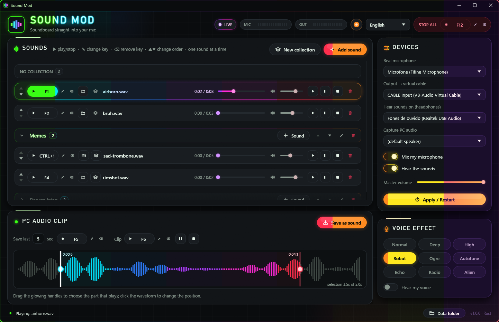

# Sound Mod — User Manual

**English** | [Português](MANUAL.pt-BR.md)



**Sound Mod** is a Windows soundboard: press a key and a sound plays **on your microphone**, for whoever is with you on Discord, in a game, on a call or on a stream, while you keep talking normally. It also records the last few seconds of your PC audio so you can trim it and play it on your mic, and it has live voice effects.

## Contents

1. [Requirements](#1-requirements)
2. [The virtual cable (VB-CABLE)](#2-the-virtual-cable-vb-cable)
3. [Installing Sound Mod](#3-installing-sound-mod)
4. [First setup](#4-first-setup)
5. [Setting up Discord, games and other apps](#5-setting-up-discord-games-and-other-apps)
6. [The Sound Mod window](#6-the-sound-mod-window)
7. [Sounds](#7-sounds)
8. [Hotkeys](#8-hotkeys)
9. [PC audio clip](#9-pc-audio-clip)
10. [Voice effects](#10-voice-effects)
11. [Appearance and language](#11-appearance-and-language)
12. [Where your data lives, updating and uninstalling](#12-where-your-data-lives-updating-and-uninstalling)
13. [Troubleshooting](#13-troubleshooting)

---

## 1. Requirements

- Windows 10 or 11, 64-bit.
- **VB-CABLE**, a free virtual audio cable (see the next section). Without it the app opens, but it has no way to send sound to the microphone.
- A microphone (to talk along with the sounds) and headphones (so you hear the sounds while they play).

## 2. The virtual cable (VB-CABLE)

### Why a virtual cable is needed

Windows doesn't let a program "inject" audio into a real microphone. The solution is a **virtual audio cable**: a pair of fake devices that Windows sees as if they were sound cards.

- **CABLE Input** shows up as an **output** (like a speaker). Whatever a program plays into it goes into the cable.
- **CABLE Output** shows up as an **input** (like a microphone). Whatever went into the cable comes out of it.

Sound Mod mixes your real microphone with the sounds and plays the result into **CABLE Input**. In Discord (or the game) you pick **CABLE Output** as your microphone. That way, the people with you hear your voice and the sounds together.

```
Your microphone ──┐
                  ├─► Sound Mod ─► CABLE Input ═══► CABLE Output ─► Discord / game (as microphone)
Sounds (F1, F2…) ─┘       └─► your headphones (so you hear the sounds)
```

You need **one** cable only. Sound Mod uses **VB-CABLE** by VB-Audio, which is free (donationware).

### Installing VB-CABLE

1. Open **https://vb-audio.com/Cable/** and download the **VB-CABLE Driver Pack** (a `.zip` file).
2. Right-click the `.zip` and choose **Extract All…**. Don't run the installer from inside the `.zip` without extracting it.
3. In the extracted folder, right-click **`VBCABLE_Setup_x64.exe`** and choose **Run as administrator**.
4. Click **Install Driver** and confirm. A message says when the installation is complete.
5. **Restart your computer.** The cable only works properly after a restart.

### Checking that the cable is installed

Open Windows **Settings → System → Sound**:

- Under **Output** you should see **CABLE Input (VB-Audio Virtual Cable)**.
- Under **Input** you should see **CABLE Output (VB-Audio Virtual Cable)**.

> [!WARNING]
> **Don't leave CABLE Input as Windows' default output device.** Sometimes, after the installation, Windows switches the default output to it: then you stop hearing your PC, and everything playing on the computer ends up on your microphone. If that happens, set the default output back to your headphones or speakers on that same screen.

### Uninstalling VB-CABLE

Run `VBCABLE_Setup_x64.exe` as administrator again, click **Remove Driver** and restart.

### Other virtual cables

Sound Mod works with any virtual cable (for example, VB-Audio Hi-Fi Cable or VoiceMeeter). It only recognizes **automatically** the ones with "CABLE" in their name; with another cable, choose its input manually in **Output → virtual cable** (section 4).

## 3. Installing Sound Mod

1. On the **[Releases](https://github.com/renanzm/sound-mod-rs/releases/latest)** page, download **`SoundMod-v1.0.0-windows-x64.zip`** (program + manual) or just **`SoundMod.exe`**.
2. Extract the `.zip` to a folder of your own (for example, `Documents\SoundMod`) and open **`SoundMod.exe`**. Nothing else needs to be installed besides VB-CABLE.

> [!NOTE]
> Since the program isn't digitally signed yet, Windows may show **"Windows protected your PC"** (SmartScreen) the first time. Click **More info → Run anyway**. Some antivirus programs are also suspicious of programs that read global keys (that is what lets hotkeys work inside games); the code is open source and lives in this repository.

## 4. First setup

On the first start, Sound Mod already tries to pick the devices by itself. Check them in the **Devices** panel on the right:

| Field | What to choose |
|---|---|
| **Real microphone** | your actual microphone |
| **Output → virtual cable** | **CABLE Input (VB-Audio Virtual Cable)** |
| **Hear sounds on (headphones)** | your headphones. **Don't** choose the cable here |
| **Capture PC audio** | where the clip records from; the default is Windows' default speaker |

Then click **Apply / Restart**. The **LIVE** indicator at the top lights up when audio is on, and the **MIC** and **OUT** meters move when there is sound.

More options in the same panel:

- **Mix my microphone**: sends your voice along with the sounds. When off, only the sounds go to the cable.
- **Hear the sounds**: also plays the sounds in your headphones, so you hear what the others hear.
- **Master volume**: volume of all sounds (it doesn't change your voice).

Device changes only take effect after **Apply / Restart**. Switches and volumes apply immediately.

## 5. Setting up Discord, games and other apps

### Discord

In **User Settings → Voice & Video**:

1. **Input Device**: **CABLE Output (VB-Audio Virtual Cable)**.
2. Turn off **Noise Suppression** (Krisp), **Echo Cancellation** and **Automatic Gain Control**. They are made to clean up voice and tend to cut or muffle sound effects.
3. Under **Input Sensitivity**, if sounds get cut at the start, turn off the automatic setting and lower the threshold.

> [!IMPORTANT]
> If you use **Push to Talk**, Discord only transmits while the key is held. The sounds play into the cable, but nobody hears them unless you're holding it. Use **Voice Activity** or hold the key while the sound plays.

### Games, calls and streams

The principle is the same in any app: pick **CABLE Output** as the microphone in the voice settings of the game (or Teams, Zoom, WhatsApp, etc.). Games that don't let you choose the microphone use Windows' **default input device**; in that case, in **Settings → System → Sound → Input**, set **CABLE Output** as the default while you play.

In **OBS**, so the stream also hears the sounds, use an **Audio Input Capture** source with **CABLE Output** (instead of your microphone, so your voice isn't doubled).

## 6. The Sound Mod window

- **Header**: the logo (its bars dance with the outgoing sound), the **LIVE** indicator, the **MIC** and **OUT** meters, the **neon color** dot, the **language** menu and **STOP ALL** (which also has a key, F12 by default).
- **Sounds**: your list of sounds (section 7).
- **PC audio clip**: records and trims parts of the computer's sound (section 9).
- **Devices** and **Voice effect**: the right panel (sections 4 and 10).
- **Status bar**, at the bottom: shows what just happened (sound playing, key changed, errors). On the right, **Data folder** opens the folder that holds your settings.

## 7. Sounds

### Adding sounds

- **Add sound** opens the file picker and accepts **several files at once**. They fill the empty spots of the list first.
- The **folder** button on each row changes that sound's file.
- Formats: **mp3, wav, ogg (Vorbis), flac, m4a/aac, aiff** and others open directly. For **wma** or **opus**, put an `ffmpeg.exe` in the same folder as `SoundMod.exe`.

Every added file is **copied** into the app's sounds folder; the original stays where it was. That way your sounds keep working even if you move or delete the original files. **Open folder**, at the top of the list, opens that folder.

### Each sound row

From left to right:

| Control | What it does |
|---|---|
| **▲ ▼** | moves the sound up or down the list (within its group) |
| **▶ F1** | plays the sound; pressed again, stops it. Shows the hotkey |
| **✎** | changes the hotkey (section 8) |
| **⌫** | removes the hotkey (the button still works with the mouse) |
| **folder** | changes the file |
| **layers** | puts the sound in a collection or takes it out |
| name and time | file name and `position / duration` |
| progress bar | drag to skip forward or back |
| **volume** | volume of this sound only (up to 150%) |
| **▶ ⏸ ■** | play (restarts if already playing), pause/resume, stop |
| **trash** | removes the sound from the list (the file in the sounds folder isn't deleted) |

**Only one sound plays at a time**: playing another stops the current one. The playing row lights up with a pulsing glow.

### Collections

To organize many sounds, create groups:

- **New collection** creates a group (the name can't be empty or repeat another one).
- The **layers** button on each sound opens a menu to choose its collection (or **+ New collection**, which creates one and moves the sound into it).
- On each collection header: the **arrow** (or the name) collapses/expands it, **+ Sound** adds files straight into it, **▲ ▼** move the collection, **✎** renames it and the **trash** deletes the collection. Its sounds are not deleted: they go back to **No collection**.
- Hotkeys keep working for sounds in collapsed collections.

### Compact list

The **Compact list** switch makes each row thinner, so more sounds fit in the window.

## 8. Hotkeys

- Hotkeys work **anywhere**: with Sound Mod in the background, minimized, or with a game in full screen. The key still reaches the game normally.
- Defaults: **F1 to F4** for the first sounds, **F5** saves the clip, **F6** plays the clip and **F12** stops everything.
- To change one: click the **✎** next to the key and press the new key or combination (for example, `Ctrl+1`, `Shift+F3`, `Num 5`). **Esc** cancels.
- To remove a key, click the **⌫**.

> [!TIP]
> If hotkeys don't work while a game is open, the game is probably running **as administrator**. Windows doesn't let a regular program read the keys of a program with higher permissions: run Sound Mod as administrator too (right-click → **Run as administrator**).

## 9. PC audio clip

Sound Mod keeps recording, without saving, the last few seconds of the computer's sound (whatever you're hearing: a video, the game, music).

1. In **Save last _N_ sec**, choose how many seconds to keep (1 to 60; the default is 5).
2. Press **F5** (or the **●** button) to save the last seconds. The waveform appears.
3. **Drag the glowing handles** on the waveform to choose the part that plays. Click the waveform to change the position.
4. Press **F6** (or **▶**) to play the part on the microphone. **⏸** and **■** pause and stop.
5. **Save as sound** asks for a name and adds the selected part to your list of sounds.

> [!NOTE]
> If nothing is playing on the PC, there is nothing to record ("Nothing recorded yet"). And if Sound Mod's sounds are playing on the same headphones you record from, they also end up in the clip.

## 10. Voice effects

In the **Voice effect** panel, choose how your voice comes out on the microphone, live: **Normal** (no effect), **Deep**, **High**, **Robot**, **Ogre**, **Autotune**, **Echo**, **Radio** and **Alien**.

Turn on **Hear my voice** to listen in your headphones to how you sound. Effects only change your voice, not the sounds.

## 11. Appearance and language

- **Neon color**: click the glowing dot in the header and choose green, cyan, blue, purple, pink, red, orange or yellow, or the **Vice City** theme (violet backgrounds with a sunset gradient). The interface, the window border and the icon change immediately.
- **Language**: the **Português / English** menu in the header switches the language immediately. On the first start, the app follows Windows' language.

All of this is saved for next time.

## 12. Where your data lives, updating and uninstalling

Your settings and sounds live in **`%APPDATA%\SoundMod`** (the **Data folder** button opens it):

| File / folder | Contents |
|---|---|
| `config.json` | devices, sounds, keys, collections, color, language |
| `sounds\` | all your sounds (added ones and the ones created from the clip) |
| `clips\last_clip.wav` | the last saved clip |

- **Updating**: download the new version and replace `SoundMod.exe`. Your data stays where it is.
- **Moving to another PC / backup**: copy the `%APPDATA%\SoundMod` folder.
- **Coming from the old Python version**: put the new `SoundMod.exe` in the old version's folder (or copy `config.json` and the `sounds\` folder next to it). Your settings are imported on the first start.
- **Uninstalling**: delete the folder with `SoundMod.exe` and the `%APPDATA%\SoundMod` folder. To remove the virtual cable, see section 2.

## 13. Troubleshooting

| Problem | What to do |
|---|---|
| **"Virtual cable not found"** warning | Install VB-CABLE (section 2), **restart the PC** and open Sound Mod again. |
| Others **don't hear the sounds** | In Discord/the game, the microphone must be **CABLE Output**. In Sound Mod, **Output → virtual cable** must be **CABLE Input** and **LIVE** must be lit. Turn off noise suppression and check **Push to Talk** (section 5). |
| Others **don't hear my voice** | Turn on **Mix my microphone** and check **Real microphone**. In Windows **Settings → Privacy & security → Microphone**, let desktop apps access the microphone. |
| **I don't hear the sounds** | In **Hear sounds on (headphones)**, choose your headphones and turn on **Hear the sounds**. |
| **Echo** or doubled sound | **Hear sounds on** must not be the cable. Check that **CABLE Input** didn't become Windows' default output (section 2). |
| I stopped hearing my PC | Windows switched the default output to **CABLE Input**. Set it back to your headphones in **Settings → System → Sound**. |
| **Hotkeys don't work** in a game | Run Sound Mod **as administrator** (section 8). Also check that a game key isn't the same. |
| **"Nothing recorded yet"** when saving the clip | Nothing was playing on the PC. Check **Capture PC audio**. |
| **"An audio device was disconnected"** | Reconnect the device (or choose another) and click **Apply / Restart**. |
| A file **won't open** | For wma and opus, put an `ffmpeg.exe` in the `SoundMod.exe` folder. |
| Windows **blocked** the program | See the SmartScreen note in section 3. |

If something goes wrong and the program closes by itself, the error is saved to `%APPDATA%\SoundMod\soundmod-error.log`. To report a problem, open an issue at **https://github.com/renanzm/sound-mod-rs/issues** with that file and what you were doing.
