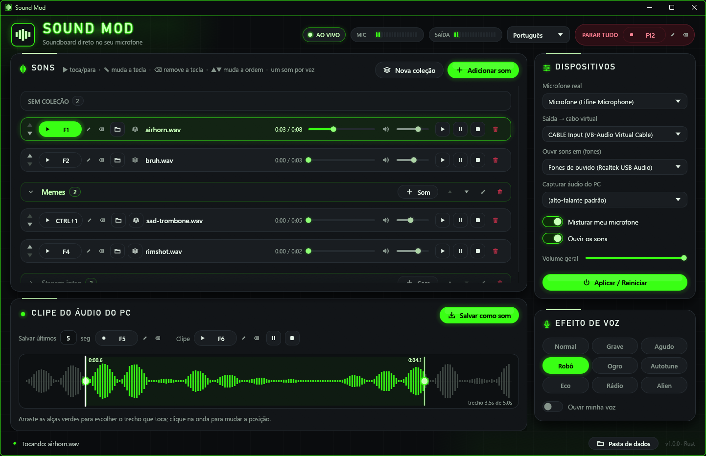

# Sound Mod — Manual de uso

[English](MANUAL.md) | **Português**



O **Sound Mod** é um soundboard para Windows: você aperta uma tecla e um som toca **no seu microfone**, para quem está com você no Discord, num jogo, numa chamada ou numa live, enquanto você continua falando normalmente. Ele também grava os últimos segundos do áudio do PC para você cortar e tocar no microfone, e tem efeitos de voz ao vivo.

## Sumário

1. [Requisitos](#1-requisitos)
2. [O cabo virtual (VB-CABLE)](#2-o-cabo-virtual-vb-cable)
3. [Instalar o Sound Mod](#3-instalar-o-sound-mod)
4. [Primeira configuração](#4-primeira-configuração)
5. [Configurar o Discord, jogos e outros apps](#5-configurar-o-discord-jogos-e-outros-apps)
6. [A janela do Sound Mod](#6-a-janela-do-sound-mod)
7. [Sons](#7-sons)
8. [Teclas de atalho](#8-teclas-de-atalho)
9. [Clipe do áudio do PC](#9-clipe-do-áudio-do-pc)
10. [Efeitos de voz](#10-efeitos-de-voz)
11. [Aparência e idioma](#11-aparência-e-idioma)
12. [Onde ficam seus dados, atualizar e desinstalar](#12-onde-ficam-seus-dados-atualizar-e-desinstalar)
13. [Solução de problemas](#13-solução-de-problemas)

---

## 1. Requisitos

- Windows 10 ou 11, 64 bits.
- O **VB-CABLE**, um cabo de áudio virtual gratuito (veja a próxima seção). Sem ele o app abre, mas não tem como mandar som para o microfone.
- Um microfone (para falar junto com os sons) e fones de ouvido (para você ouvir os sons enquanto eles tocam).

## 2. O cabo virtual (VB-CABLE)

### Por que precisa de um cabo virtual

O Windows não deixa um programa "injetar" áudio dentro de um microfone de verdade. A solução é um **cabo de áudio virtual**: um par de dispositivos falsos que o Windows passa a enxergar como se fossem placas de som.

- **CABLE Input** aparece como uma **saída** (como se fosse uma caixa de som). Tudo o que um programa toca nela entra no cabo.
- **CABLE Output** aparece como uma **entrada** (como se fosse um microfone). Tudo o que entrou no cabo sai por ela.

O Sound Mod junta o seu microfone de verdade com os sons e toca o resultado no **CABLE Input**. No Discord (ou no jogo) você escolhe o **CABLE Output** como microfone. Assim, quem está com você ouve a sua voz e os sons juntos.

```
Seu microfone ──┐
                ├─► Sound Mod ─► CABLE Input ═══► CABLE Output ─► Discord / jogo (como microfone)
Sons (F1, F2…) ─┘       └─► seus fones (para você ouvir os sons)
```

Você precisa de **um** cabo só. O Sound Mod usa o **VB-CABLE**, da VB-Audio, que é gratuito (doação opcional).

### Instalar o VB-CABLE

1. Abra **https://vb-audio.com/Cable/** e baixe o **VB-CABLE Driver Pack** (um arquivo `.zip`).
2. Clique com o botão direito no `.zip` e escolha **Extrair tudo…**. Não rode o instalador de dentro do `.zip` sem extrair.
3. Na pasta extraída, clique com o botão direito em **`VBCABLE_Setup_x64.exe`** e escolha **Executar como administrador**.
4. Clique em **Install Driver** e confirme. No fim aparece uma mensagem de instalação concluída.
5. **Reinicie o computador.** O cabo só funciona direito depois de reiniciar.

### Conferir se o cabo está instalado

Abra **Configurações → Sistema → Som** do Windows:

- Em **Saída** deve aparecer **CABLE Input (VB-Audio Virtual Cable)**.
- Em **Entrada** deve aparecer **CABLE Output (VB-Audio Virtual Cable)**.

> [!WARNING]
> **Não deixe o CABLE Input como o dispositivo de saída padrão do Windows.** Às vezes, depois da instalação, o Windows troca a saída padrão para ele: aí você para de ouvir o som do PC, e tudo o que toca no computador vai parar no seu microfone. Se isso acontecer, volte a saída padrão para os seus fones ou caixas de som nessa mesma tela.

### Desinstalar o VB-CABLE

Rode `VBCABLE_Setup_x64.exe` como administrador de novo, clique em **Remove Driver** e reinicie.

### Outros cabos virtuais

O Sound Mod funciona com qualquer cabo virtual (por exemplo, o VB-Audio Hi-Fi Cable ou o VoiceMeeter). Ele só reconhece **automaticamente** os que têm "CABLE" no nome; com outro cabo, escolha a entrada dele manualmente em **Saída → cabo virtual** (seção 4).

## 3. Instalar o Sound Mod

1. Na página de **[Releases](https://github.com/renanzm/sound-mod-rs/releases/latest)**, baixe **`SoundMod-v1.0.0-windows-x64.zip`** (programa + manual) ou só o **`SoundMod.exe`**.
2. Extraia o `.zip` numa pasta sua (por exemplo, `Documentos\SoundMod`) e abra o **`SoundMod.exe`**. Não precisa instalar nada além do VB-CABLE.

> [!NOTE]
> Como o programa ainda não é assinado digitalmente, o Windows pode mostrar **"O Windows protegeu o computador"** (SmartScreen) na primeira vez. Clique em **Mais informações → Executar assim mesmo**. Alguns antivírus também desconfiam de programas que leem teclas globais (é o que permite as teclas funcionarem dentro do jogo); o código é aberto e está neste repositório.

## 4. Primeira configuração

Na primeira vez, o Sound Mod já tenta escolher os dispositivos sozinho. Confira no painel **Dispositivos**, à direita:

| Campo | O que escolher |
|---|---|
| **Microfone real** | o seu microfone de verdade |
| **Saída → cabo virtual** | **CABLE Input (VB-Audio Virtual Cable)** |
| **Ouvir sons em (fones)** | os seus fones de ouvido. **Não** escolha o cabo aqui |
| **Capturar áudio do PC** | de onde o clipe grava; o padrão é o alto-falante padrão do Windows |

Depois clique em **Aplicar / Reiniciar**. O indicador **AO VIVO** no topo acende quando o áudio está ligado, e os medidores **MIC** e **SAÍDA** se mexem quando há som.

Mais opções no mesmo painel:

- **Misturar meu microfone**: manda a sua voz junto com os sons. Desligado, só os sons vão para o cabo.
- **Ouvir os sons**: toca os sons também nos seus fones, para você ouvir o que os outros estão ouvindo.
- **Volume geral**: volume de todos os sons (não muda o da sua voz).

Trocas de dispositivo só valem depois de **Aplicar / Reiniciar**. Interruptores e volumes valem na hora.

## 5. Configurar o Discord, jogos e outros apps

### Discord

Em **Configurações do usuário → Voz e vídeo**:

1. **Dispositivo de entrada**: **CABLE Output (VB-Audio Virtual Cable)**.
2. Desligue **Supressão de ruído** (Krisp), **Cancelamento de eco** e **Controle automático de ganho**. Eles foram feitos para limpar voz e costumam cortar ou abafar os efeitos sonoros.
3. Em **Sensibilidade de entrada**, se os sons forem cortados no começo, desligue o ajuste automático e baixe o limite.

> [!IMPORTANT]
> Se você usa **Apertar para falar**, o Discord só transmite enquanto a tecla está apertada. Os sons tocam no cabo, mas ninguém ouve se você não estiver apertando. Use **Detecção de voz** ou segure a tecla enquanto o som toca.

### Jogos, chamadas e lives

O princípio é o mesmo em qualquer app: escolha **CABLE Output** como microfone nas configurações de voz do jogo (ou do Teams, Zoom, WhatsApp etc.). Em jogos que não deixam escolher o microfone, eles usam o **dispositivo de entrada padrão** do Windows; nesse caso, em **Configurações → Sistema → Som → Entrada**, deixe o **CABLE Output** como padrão enquanto joga.

No **OBS**, para a live também ouvir os sons, use uma fonte **Captura de entrada de áudio** com o **CABLE Output** (no lugar do seu microfone, para não duplicar a voz).

## 6. A janela do Sound Mod

- **Cabeçalho**: o logo (as barrinhas dançam com o som que sai), o indicador **AO VIVO**, os medidores **MIC** e **SAÍDA**, a bolinha da **cor do neon**, o menu de **idioma** e **PARAR TUDO** (que também tem tecla, F12 por padrão).
- **Sons**: a sua lista de sons (seção 7).
- **Clipe do áudio do PC**: grava e corta trechos do som do computador (seção 9).
- **Dispositivos** e **Efeito de voz**: painel da direita (seções 4 e 10).
- **Barra de status**, embaixo: mostra o que acabou de acontecer (som tocando, tecla trocada, erros). À direita, **Pasta de dados** abre a pasta onde ficam suas configurações.

## 7. Sons

### Adicionar sons

- **Adicionar som** abre o seletor de arquivos e aceita **vários arquivos de uma vez**. Eles ocupam primeiro os espaços vazios da lista.
- O botão de **pasta** em cada linha troca o arquivo daquele som.
- Formatos: **mp3, wav, ogg (Vorbis), flac, m4a/aac, aiff** e outros abrem direto. Para **wma** ou **opus**, coloque um `ffmpeg.exe` na mesma pasta do `SoundMod.exe`.

Todo arquivo adicionado é **copiado** para a pasta de sons do app; o original fica onde estava. Assim seus sons continuam funcionando mesmo se você mover ou apagar os arquivos originais. **Abrir pasta**, no topo da lista, abre essa pasta.

### Cada linha de som

Da esquerda para a direita:

| Controle | Função |
|---|---|
| **▲ ▼** | muda a posição do som na lista (dentro do grupo dele) |
| **▶ F1** | toca o som; apertado de novo, para. Mostra a tecla de atalho |
| **✎** | troca a tecla de atalho (seção 8) |
| **⌫** | remove a tecla de atalho (o botão continua funcionando com o mouse) |
| **pasta** | troca o arquivo |
| **camadas** | põe o som numa coleção ou tira dela |
| nome e tempo | nome do arquivo e `posição / duração` |
| barra de progresso | arraste para avançar ou voltar |
| **volume** | volume só deste som (até 150%) |
| **▶ ⏸ ■** | tocar (recomeça se já estava tocando), pausar/continuar, parar |
| **lixeira** | tira o som da lista (o arquivo na pasta de sons não é apagado) |

**Só um som toca por vez**: tocar outro para o que estava tocando. A linha que está tocando fica acesa, com brilho pulsando.

### Coleções

Para organizar muitos sons, crie grupos:

- **Nova coleção** cria um grupo (o nome não pode ficar vazio nem repetir outro).
- O botão de **camadas** de cada som abre um menu para escolher a coleção dele (ou **+ Nova coleção**, que já cria e move).
- No cabeçalho de cada coleção: a **seta** (ou o nome) recolhe/expande, **+ Som** adiciona arquivos direto nela, **▲ ▼** mudam a coleção de lugar, **✎** renomeia e a **lixeira** apaga a coleção. Os sons dela não são apagados: voltam para **Sem coleção**.
- As teclas de atalho dos sons continuam funcionando mesmo com a coleção recolhida.

### Lista compacta

O interruptor **Lista compacta** deixa cada linha mais fina, para caber mais sons na janela.

## 8. Teclas de atalho

- As teclas funcionam **em qualquer lugar**: com o Sound Mod em segundo plano, minimizado, ou com o jogo em tela cheia. A tecla continua chegando normalmente ao jogo.
- Padrão: **F1 a F4** para os primeiros sons, **F5** salva o clipe, **F6** toca o clipe e **F12** para tudo.
- Para trocar: clique no **✎** ao lado da tecla e aperte a nova tecla ou combinação (por exemplo, `Ctrl+1`, `Shift+F3`, `Num 5`). **Esc** cancela.
- Para tirar a tecla, clique no **⌫**.

> [!TIP]
> Se as teclas não funcionarem com um jogo aberto, o jogo provavelmente está rodando **como administrador**. O Windows não deixa um programa comum ler as teclas de um programa com mais permissão: abra o Sound Mod como administrador também (botão direito → **Executar como administrador**).

## 9. Clipe do áudio do PC

O Sound Mod fica gravando, sem salvar, os últimos segundos do som do computador (o que você está ouvindo: um vídeo, o jogo, uma música).

1. Em **Salvar últimos _N_ seg**, escolha quantos segundos guardar (1 a 60; o padrão é 5).
2. Aperte **F5** (ou o botão **●**) para salvar os últimos segundos. A forma de onda aparece.
3. **Arraste as alças acesas** na forma de onda para escolher o trecho que vai tocar. Clique na onda para mudar a posição.
4. Aperte **F6** (ou **▶**) para tocar o trecho no microfone. **⏸** e **■** pausam e param.
   - **Tom**: o controle ao lado de **Salvar como som** deixa o clipe mais agudo ou mais grave ao tocar (de −12 a +12 semitons; o **⌫** volta ao original). Mais agudo também toca mais rápido, e mais grave, mais devagar: ótimo para devolver a voz de um amigo como esquilo ou monstro. O arquivo gravado não muda, e o tom fica salvo.
5. **Salvar como som** pede um nome e adiciona o trecho escolhido à sua lista de sons.

> [!NOTE]
> Se nada estiver tocando no PC, não há o que gravar ("Nada gravado ainda"). E se os sons do Sound Mod estiverem tocando nos mesmos fones que você grava, eles também entram no clipe.

## 10. Efeitos de voz

No painel **Efeito de voz**, escolha como a sua voz sai no microfone, ao vivo: **Normal** (sem efeito), **Grave**, **Agudo**, **Robô**, **Ogro**, **Autotune**, **Eco**, **Rádio** e **Alien**.

Ligue **Ouvir minha voz** para escutar nos fones como você está saindo. Os efeitos só mudam a sua voz, não os sons.

## 11. Aparência e idioma

- **Cor do neon**: clique na bolinha acesa do cabeçalho e escolha entre verde, ciano, azul, roxo, rosa, vermelho, laranja e amarelo, ou o tema **Vice City** (fundos violeta com degradê de pôr do sol). A interface, a borda da janela e o ícone mudam na hora.
- **Idioma**: o menu **Português / English** do cabeçalho troca o idioma na hora. Na primeira vez, o app segue o idioma do Windows.

Tudo isso fica salvo para a próxima vez.

## 12. Onde ficam seus dados, atualizar e desinstalar

Suas configurações e sons ficam em **`%APPDATA%\SoundMod`** (o botão **Pasta de dados** abre essa pasta):

| Arquivo / pasta | Conteúdo |
|---|---|
| `config.json` | dispositivos, sons, teclas, coleções, cor, idioma |
| `sounds\` | todos os seus sons (os adicionados e os criados pelo clipe) |
| `clips\last_clip.wav` | o último clipe salvo |

- **Atualizar**: baixe a versão nova e substitua o `SoundMod.exe`. Seus dados ficam onde estão.
- **Levar para outro PC / backup**: copie a pasta `%APPDATA%\SoundMod`.
- **Vindo da versão antiga em Python**: coloque o `SoundMod.exe` novo na pasta da versão antiga (ou copie o `config.json` e a pasta `sounds\` para o lado dele). Na primeira abertura, as configurações são importadas.
- **Desinstalar**: apague a pasta onde está o `SoundMod.exe` e a pasta `%APPDATA%\SoundMod`. Para tirar o cabo virtual, veja a seção 2.

## 13. Solução de problemas

| Problema | O que fazer |
|---|---|
| Aviso **"Cabo virtual não encontrado"** | Instale o VB-CABLE (seção 2), **reinicie o PC** e abra o Sound Mod de novo. |
| Os outros **não ouvem os sons** | No Discord/jogo, o microfone tem que ser **CABLE Output**. No Sound Mod, **Saída → cabo virtual** tem que ser **CABLE Input** e o **AO VIVO** tem que estar aceso. Desligue a supressão de ruído e confira o **Apertar para falar** (seção 5). |
| Os outros **não ouvem a minha voz** | Ligue **Misturar meu microfone** e confira o **Microfone real**. Em **Configurações → Privacidade e segurança → Microfone** do Windows, deixe os aplicativos da área de trabalho acessarem o microfone. |
| **Eu não ouço os sons** | Em **Ouvir sons em (fones)**, escolha os seus fones e ligue **Ouvir os sons**. |
| **Eco** ou som duplicado | **Ouvir sons em** não pode ser o cabo. Confira se o **CABLE Input** não virou a saída padrão do Windows (seção 2). |
| Parei de ouvir o som do PC | O Windows trocou a saída padrão para o **CABLE Input**. Volte para os seus fones em **Configurações → Sistema → Som**. |
| As **teclas não funcionam** no jogo | Abra o Sound Mod **como administrador** (seção 8). Confira também se outra tecla do jogo não é a mesma. |
| **"Nada gravado ainda"** ao salvar o clipe | Não havia som tocando no PC. Confira **Capturar áudio do PC**. |
| **"Um dispositivo de áudio foi desconectado"** | Reconecte o dispositivo (ou escolha outro) e clique em **Aplicar / Reiniciar**. |
| Um arquivo **não abre** | Para wma e opus, coloque um `ffmpeg.exe` na pasta do `SoundMod.exe`. |
| O Windows **bloqueou** o programa | Veja a nota sobre o SmartScreen na seção 3. |

Se algo der errado de um jeito que o programa fecha sozinho, o erro fica salvo em `%APPDATA%\SoundMod\soundmod-error.log`. Para relatar um problema, abra uma *issue* em **https://github.com/renanzm/sound-mod-rs/issues** com esse arquivo e o que você estava fazendo.
